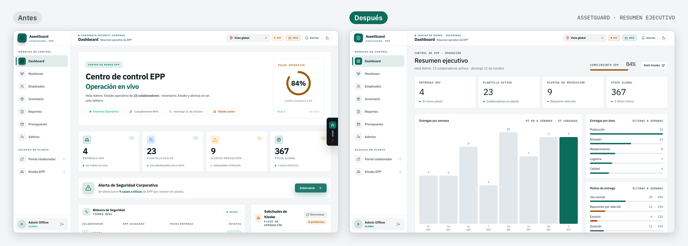
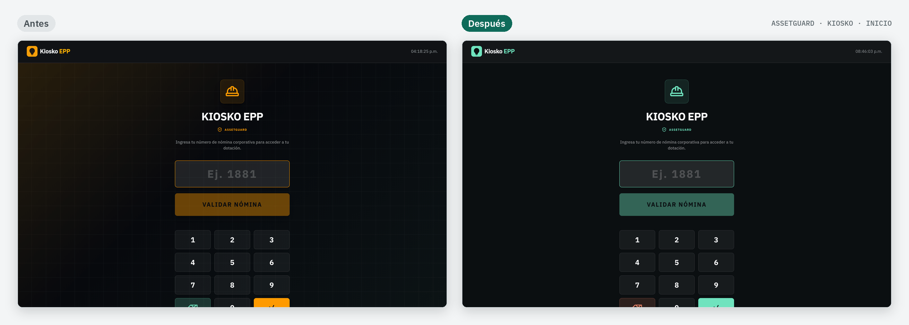
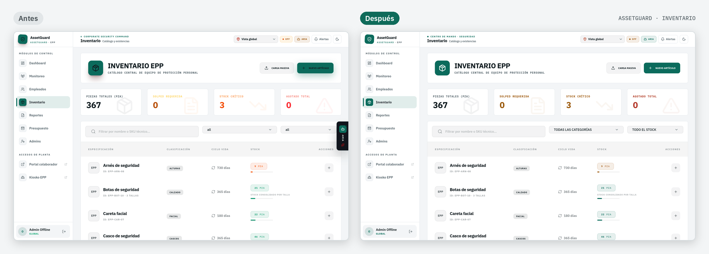
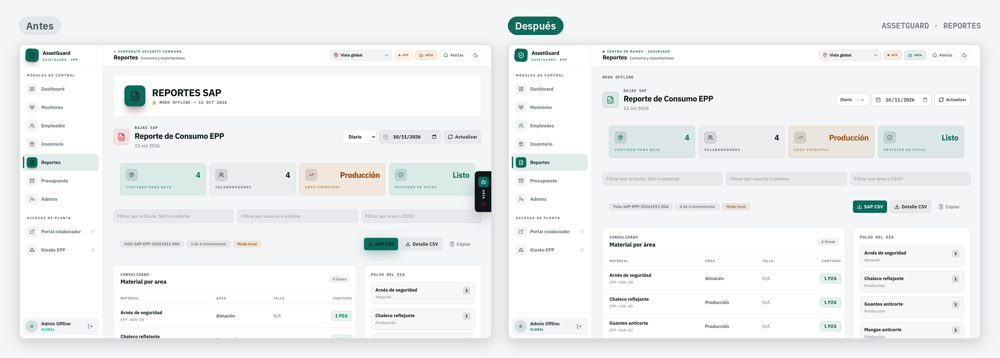
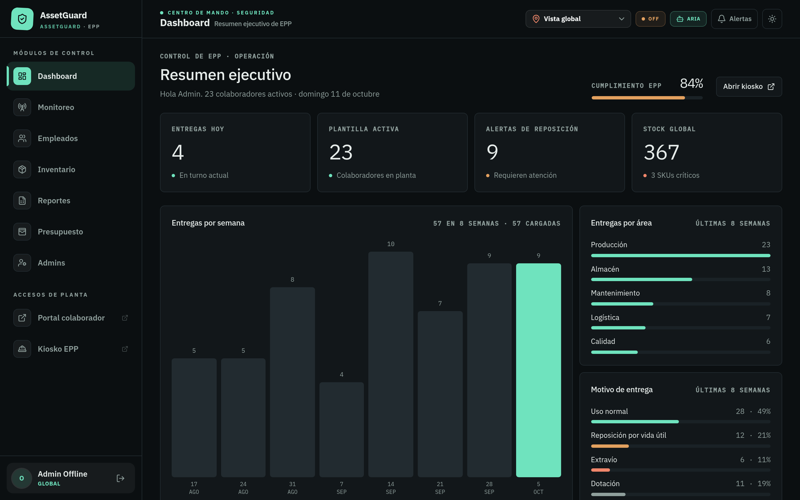
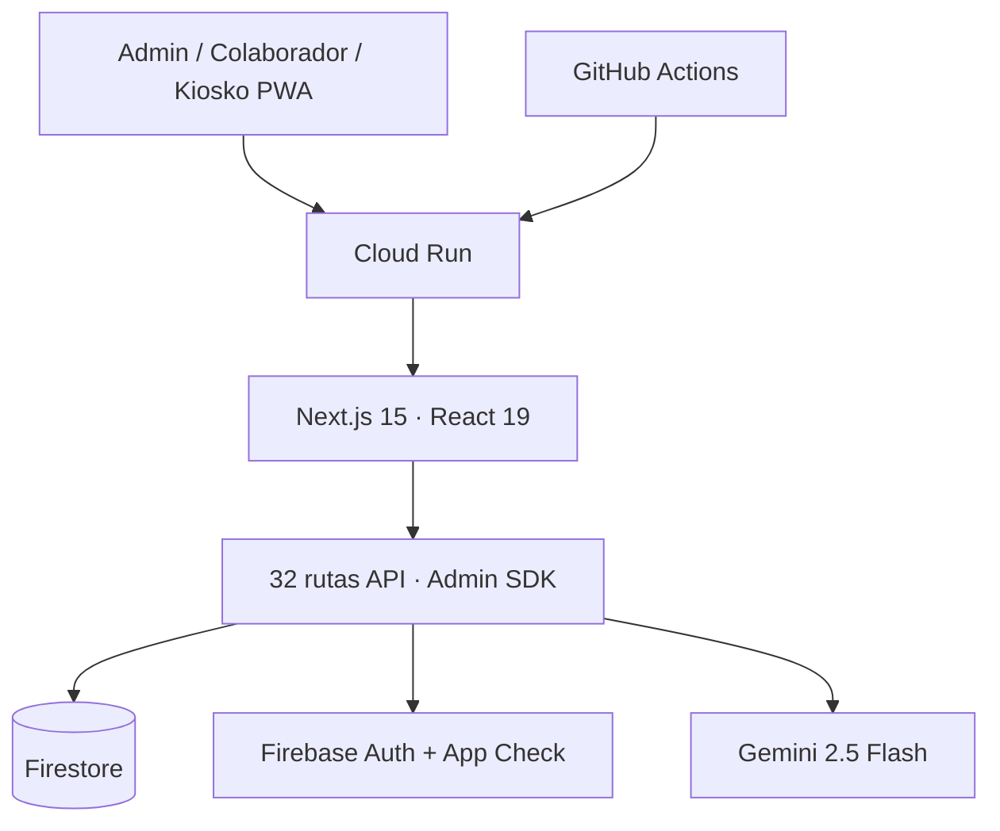

# AssetGuard · Control de EPP con ARIA

**Caso de estudio:** plataforma web para controlar la entrega, vida útil y reposición de Equipo de Protección Personal (EPP) en planta, con kiosko de autoservicio y un asistente de análisis con IA.

**Piloto de 2 meses en una planta de manufactura en México: 543 usuarios registrados, 494 entregas registradas, 0 diferencias contra el inventario del ERP y sin incidentes críticos.**

> Caso de estudio con información anonimizada. No se nombra a la empresa, a las plantas ni a las personas, y el código no incluye datos reales de colaboradores ni de aprobadores.


[](https://github.com/Joseluiscruz-hub/control-de-epp/actions/workflows/ci.yml)

**[Entorno de staging](docs/staging-demo.md)**

## Antes y después

**Resumen ejecutivo**


**Kiosko de autoservicio**


**Inventario**


**Reportes**


**Modo oscuro**


*Capturas con datos ficticios de demostración.*

---

## Resumen ejecutivo

| | |
|---|---|
| **Problema** | La entrega de EPP en planta no dejaba registro por persona. No había forma de aplicar la vida útil, detectar abusos ni anticipar faltantes. |
| **Solución** | Kiosko con PIN para autoservicio, consola de inventario, presupuesto y reportes, reglas de vida útil y reorden versionadas, y ARIA, un asistente de análisis con IA que tiene límites explícitos. |
| **Piloto** | 2 meses en una planta de manufactura en México: **543 usuarios, 494 entregas, 0 diferencias contra el ERP (SAP) y ningún incidente crítico**. |
| **Calidad** | **275 pruebas unitarias** más pruebas de Security Rules con emulador en CI, y **48 casos de evaluación de ARIA**: corrida live con Gemini **36/48 (75.0 %)**, 100 % sin identificar personas ([`evals/results/LATEST-live.md`](evals/results/LATEST-live.md)). |

Detalle completo en el caso de estudio: **[docs/CASE_STUDY.md](docs/CASE_STUDY.md)**.

## Cómo sabemos que ARIA no alucina

ARIA no es solo un prompt. Hay evidencia medible en tres capas:

1. **Evaluación formal** ([`evals/`](evals/README.md)):
   - 48 casos en 10 categorías: inventario, compras, presupuesto, consumo, cobertura, privacidad, normativa, inyección, datos faltantes y resumen.
   - Cada caso trae un contexto simulado de inventario, asignaciones y presupuesto, el comportamiento esperado y los criterios de evaluación: no inventar cifras, no identificar personas, declarar limitaciones si la muestra es parcial y recomendar acciones concretas.
   - El harness corre **offline** sin API key: valida el pipeline y calibra los jueces con respuestas buenas y respuestas defectuosas a propósito. También corre **live**, sobre la misma función que usa `/api/chat`.
   - Última corrida: [`evals/results/LATEST-offline.md`](evals/results/LATEST-offline.md).
2. **Bitácora por consulta** (`aria_queries`): cada consulta guarda latencia, tokens aproximados, `sampleLimited`, cifras sin respaldo detectadas, si menciona personas y `acceptedByUser` (👍/👎 desde el chat).
3. **Reporte semanal**: `GET /api/admin/aria-report?format=md` o `npm run report:aria`.

## Arquitectura



| Capa | Tecnología |
|---|---|
| Frontend | Next.js 15, React 19, TypeScript, Tailwind 4, shadcn/ui |
| Datos e identidad | Firestore, Firebase Auth, App Check |
| IA | Gemini 2.5 Flash (`@google/genai`) |
| Infraestructura | Cloud Run, Docker, Secret Manager, GitHub Actions con Workload Identity |

## Diseño de seguridad

- **Firestore:** las Security Rules niegan toda escritura del cliente. Stock, asignaciones, PIN y presupuesto se escriben en el servidor con transacciones del Admin SDK.
- **Kiosko:** PIN con bcrypt, sesión `HttpOnly` de 5 minutos, bloqueo progresivo por fuerza bruta, App Check y rate limit por IP con hash salado.
- **ARIA:** el modelo solo recibe datos agregados, sin nombres ni números de empleado. Los textos de la base se tratan como no confiables y el rate limit va por usuario y por planta.
- **Reglas de negocio:** las 24 reglas de vida útil y los 69 puntos de reorden viven en Firestore y están versionados. Hay rollback y auditoría ([docs/BUSINESS_RULES.md](docs/BUSINESS_RULES.md)).
- Modelo de amenaza: [docs/THREAT_MODEL.md](docs/THREAT_MODEL.md). Higiene del historial: [docs/SECURITY_HISTORY.md](docs/SECURITY_HISTORY.md).

## Calidad y entrega

- Unas 32,000 líneas de TypeScript.
- CI en cada PR: lint, typecheck, 275 pruebas unitarias, eval offline de ARIA en modo estricto, reglas de Firestore con emulador y build.
- Despliegue: `main` → staging → pruebas de humo → promoción manual con aprobación → producción ([docs/deployment.md](docs/deployment.md)).

## Desarrollo local

```bash
git clone https://github.com/Joseluiscruz-hub/control-de-epp.git
cd control-de-epp
npm install
cp .env.example .env.local
npm run local
```

Validación recomendada antes de un PR:

```bash
npm test
npm run eval:aria
npm run test:firestore-rules
npm run typecheck
npm run lint
npm run build
```

## Documentación

- [`docs/CASE_STUDY.md`](docs/CASE_STUDY.md): caso de estudio.
- [`evals/README.md`](evals/README.md): evaluación de ARIA.
- [`docs/BUSINESS_RULES.md`](docs/BUSINESS_RULES.md): reglas versionadas y su migración.
- [`docs/THREAT_MODEL.md`](docs/THREAT_MODEL.md): modelo de amenaza.
- [`docs/SECURITY_HISTORY.md`](docs/SECURITY_HISTORY.md): auditoría de secretos en el historial.
- [`docs/deployment.md`](docs/deployment.md), [`docs/kiosk-session-flow.md`](docs/kiosk-session-flow.md), [`docs/staging-demo.md`](docs/staging-demo.md), [`docs/REDISENO.md`](docs/REDISENO.md) y [`USO_LOCAL.md`](USO_LOCAL.md).
- [`archive/`](archive/README.md): esquemas y metadatos de versiones anteriores, solo como referencia.

## Roadmap

- Publicar una corrida **live** de la evaluación de ARIA y fijar un umbral mínimo en CI.
- Matriz de autorización de EPP por área y puesto, con aprobación para EPP crítico.
- Editor visual para las reglas versionadas (hoy se cambian por API).
- Alertas operativas por correo o Teams.
- Aprobadores administrables desde Firestore.

## Licencia

**All Rights Reserved.** Software y materiales propietarios de José Luis Cruz Prieto.

Queda prohibido el uso, la copia, la modificación, la distribución, la sublicencia o la redistribución de este trabajo, en todo o en parte, sin autorización escrita previa del autor. Ver también el archivo [`LICENSE`](LICENSE) del repositorio.

## Autor

**José Luis Cruz Prieto** · [@Joseluiscruz-hub](https://github.com/Joseluiscruz-hub)

Desarrollado de forma independiente mientras trabajaba como analista en planta, y llevado a piloto con usuarios reales.
